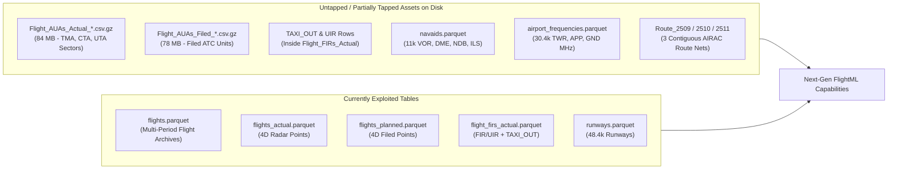

# Future Roadmap & Research Capabilities 🔭

This document surveys the **current FlightML application architecture**, audits the **complete aeronautical and meteorological data assets available on disk** (including both active and currently untapped tables), reviews the **existing reports generated**, and outlines a concrete roadmap of **what can be built next** across Air Traffic Management (ATM), airline operations research, environmental science, and deep learning.

---

> [!IMPORTANT]
> ### 🔒 Data Access & Eurocontrol OneSky Online Compliance Notice
> All proposed analytical modules and reports that operate on Eurocontrol Demand Data Repository (DDR2 / PRISME / R-NEST) archives remain subject to Eurocontrol's Data Dissemination Policy. Operational identifiers in examples below are redacted (`XXXX`).

---

## 1. Audit of Current Application, Data Assets & Reports

### 1.1 Current Reports & Analytical Outputs
FlightML currently exposes **9 interactive Streamlit dashboard tabs**, **32 CLI commands**, and **21 REST API endpoints** generating the following reports:

| Domain | Existing Module / Report | Data Sources Used | Key Output Metrics |
| :--- | :--- | :--- | :--- |
| **Network Overview** | `FlightDataset.get_summary`, `top-airports`, `top-delays` | `flights`, `raw_airports` | Traffic volume, mean dep/arr delays, route delay rankings |
| **4D Trajectory & Holding** | `analyze_trajectory`, `create_trajectory_map` | `trajectory_actual`, `trajectory_planned` | Great-circle vs. actual distance, detour ratio, 360° holding loops & stacks |
| **Descent Efficiency** | `analyze_cdo_descent` (`CDOReport`) | `trajectory_actual`, `flights` | Top of Descent (TOD), staircase level-off durations, CDO score (0–100%), excess descent fuel |
| **Fuel, Carbon & Spot Prices** | `compute_flight_fuel_and_emissions`, `jet_fuel_prices` | `flights`, `trajectory_actual`, `weekly_jet_fuel_prices` | BADA-derived burn (kg), $\text{CO}_2$ (3.16x), EIA/IATA weekly spot cost (\$/gal, \$/kg) |
| **Twin-Flight Benchmarking** | `compare_twin_flights` (`TwinFlightComparison`) | `flights`, `trajectory_actual` | Best vs. worst flight on identical `(ADEP, ADES, AC_TYPE)`: detour delta, air-time delta, fuel penalty |
| **Corridor Time-Series** | `analyze_recurring_flight_series` | `flights` | Day-over-day duration volatility, diurnal bank breakdown (Morning, Peak, Night) |
| **FIR Sector Bottlenecks** | `calculate_fir_hourly_saturation`, `calculate_flight_fir_dwell_inefficiency` | `flight_firs_actual`, `flight_firs_filed`, `raw_fir` | Hourly sector entry rate, hours $\ge$ threshold, actual vs. filed sector dwell delta |
| **Weather & Runway Winds** | `analyze_delayed_flight_weather`, `find_optimal_runways`, `analyze_network_weather_impact` | IEM ASOS/METAR API, `raw_runways`, `flights` | Crosswind/headwind vector decomposition, IFR ceiling attribution, Pearson delay correlation |
| **Rotations & Stress Testing** | `ReactionaryDelayAnalyzer`, `stress_test_airline`, `optimize_ground_delay_program` | `flights` (`ac_reg` tail tracking) | Turnaround buffer absorption, $+15\text{m}$ to $+90\text{m}$ shock infection curves, RBS Ground Delay slots |
| **Macro & AIRAC Evolution** | `compare_aviation_periods`, `compare_airac_cycles` | Multi-period `flights` (`201611` vs `202510`), `FIR_*`, `Route_*` | Decade traffic growth (+34%), fleet neo/MAX transition, added/removed airway segments |

---

### 1.2 Untapped & Under-Exploited Data Assets Already in `data/`

An inspection of `data/` and `data/extracted/202510/` reveals **high-value tables and columns already present on disk** that are either not yet ingested into Parquet or only partially utilized:

1. **ATC Unit Airspaces (`Flight_AUAs_Actual_20251001_20251031.csv.gz` & `Flight_AUAs_Filed_*.csv.gz`)**:
   - **What it is**: 162 MB of compressed records tracking every flight's entry and exit across operational **Air Traffic Control Units**—specifically **Terminal Maneuvering Areas (`*TMA`)**, **Control Areas (`*CTA`)**, and **Upper Control Areas (`*UTA`)** (e.g., `EYVITMA`, `EPWWCTA`, `LZBBCTA`).
   - **Why it matters**: FIRs are geopolitical boundaries, whereas AUAs are the actual **ATC control sectors** where tactical air traffic controllers issue clearances.
2. **Surface Movement Phase (`TAXI_OUT` in `Flight_FIRs_Actual` & `Flight_FIRs_Filed`)**:
   - **What it is**: Sequence `0` of every flight in `Flight_FIRs_Actual` is a `TAXI_OUT` record with exact off-block (`Entry Time`) and takeoff (`Exit Time`) timestamps.
   - **Why it matters**: Currently filtered out by `WHERE fir_id != 'TAXI_OUT'` in `fir_saturation.py`, this data directly measures **surface congestion, departure queue lengths, and de-icing delays** at every airport.
3. **Lower vs. Upper Airspace Split (`*FIR` vs. `*UIR` in `Flight_FIRs_Actual`)**:
   - **What it is**: Traversals distinguish lower airspace (`EYVLFIR`, `LGGGFIR`) from upper airspace (`EYVLUIR`, `LYBAUIR`, `LGGGUIR`).
   - **Why it matters**: Enables exact measurement of time spent below FL245/FL285 and detection of **flight-level capping** (where flights file into an upper UIR but are kept in a lower FIR).
4. **Global Radio Navigation Aids (`navaids.parquet` — 11,008 Navaids)**:
   - **What it is**: Full coordinates, frequencies (`frequency_khz`, `dme_channel`), magnetic variations (`slaved_variation_deg`, `magnetic_variation_deg`), power (`HIGH`, `MEDIUM`, `LOW`), and usage types (`HI`, `LO`, `RNAV`, `TERMINAL`) for global VOR, VOR-DME, VORTAC, NDB, and TACAN stations.
   - **Why it matters**: Currently loaded as `raw_navaids` in `dataset.py` but not used in any analytical module.
5. **Airport Radio Frequencies (`airport_frequencies.parquet` — 30,393 Frequencies)**:
   - **What it is**: Every `TWR`, `GND`, `APP`, `DEP`, `ATIS`, and `RDR` frequency assigned to airports worldwide.
   - **Why it matters**: Loaded as `raw_frequencies` in `dataset.py` but not yet used in reports.
6. **Multi-Cycle Airway Networks (`Route_2509.csv.gz`, `Route_2510.csv.gz`, `Route_2511.csv.gz` & `FIR_2509`/`2510`/`2511`)**:
   - **What it is**: Three consecutive 28-day AIRAC cycles inside `data/extracted/202510/`.
   - **Why it matters**: Allows tracking how flights adapt within days of an AIRAC airspace boundary or airway realignment.

---

## 2. Future Analytical Reports & Feature Roadmap

### Phase 1: Standard ICAO GANP & Eurocontrol PRU Performance Reports

Air Navigation Service Providers (ANSPs) and regulators benchmark performance using standardized **ICAO Global Air Navigation Plan (GANP)** Key Performance Indicators (KPIs). FlightML already has 100% of the data required to generate an automated **PRU / GANP Compliance Report**:

1. **KPI02 — Additional Taxi-Out Time (ATOT) & Surface Congestion**:
   - **Data**: `Flight_FIRs_Actual` (`FIR ID = 'TAXI_OUT'`) vs. `Flight_FIRs_Filed` (`FIR ID = 'TAXI_OUT'`) + `raw_runways` + `flights` (`adep`).
   - **Method**: Compute the 20th percentile unimpeded taxi-out time per `(airport, aircraft_class)` and measure excess surface holding minutes, APU/ground idle fuel burn ($\approx 12\text{–}40\text{ kg/min}$), and surface $\text{CO}_2$ emissions during peak departure banks.
2. **KPI04 & KPI05 — Horizontal En-Route Flight Efficiency (KEP vs. KEA)**:
   - **Data**: `trajectory_planned` vs. `trajectory_actual` clipped at a 40 nm cylinder around `ADEP` and `ADES`.
   - **Method**: Separate **route network design inefficiency (KEP)**—how much longer the filed flight plan is than the Great Circle—from **tactical ATC execution inefficiency (KEA)**—whether ATC gave the pilot shortcuts (`KEA < KEP`) or vectoring detours (`KEA > KEP`).
3. **KPI08 — Additional Time in Terminal Airspace (ASMA / TMA Transit)**:
   - **Data**: `Flight_AUAs_Actual` (`AUA ID LIKE '%TMA'`) + `trajectory_actual` within 40 nm / 100 nm of `ADES`.
   - **Method**: Quantify arrival metering delays inside Terminal Maneuvering Areas (`EGLL`, `LFPG`, `EDDF`, `EHAM`) independent of en-route delays.
4. **KPI17 & KPI19 — Continuous Climb Operations (CCO) & Vertical Flight Efficiency**:
   - **Data**: `trajectory_actual`, `trajectory_planned`, and `flights.requested_fl`.
   - **Method**: Extend [`cdo_analyzer.py`](file:///C:/Projects/data/FlightML/flightml/eval/cdo_analyzer.py) to the departure climb phase (**CCO**) and cruise phase (**Level-Capping Analyzer**): detect intermediate climb step-offs, late climbs due to conflicting traffic, and flights capped below their `requested_fl` (burning $+8\text{–}15\%$ more fuel in denser air).

---

### Phase 2: Airspace Design, Free Route Airspace (FRA) & Navigation Economics

1. **Free Route Airspace (FRA) vs. Conventional Airway Adherence Report**:
   - **Data**: `trajectory_actual`, `trajectory_planned`, `raw_routes` (`Route_2510`), and `raw_navaids`.
   - **Method**: Snap 4D flight waypoints to the nearest published ATS airway segment (`Route ID`) or ground navaid (`VOR`/`DME`). Measure the percentage of flight distance flown off-airway (direct-to `DCT` routing in Free Route Airspace) vs. legacy airway doglegs across European FIRs (`201611` vs. `202510`).
2. **Eurocontrol CRCO Route Charge vs. Fuel Burn Tradeoff Optimizer**:
   - **Data**: `flight_firs_actual`, `flight_firs_filed`, `weekly_jet_fuel_prices`, and aircraft MTOW classes.
   - **Method**: Eurocontrol's Central Route Charges Office (CRCO) bills operators per Charging Zone using:
     $$\text{Charge}_i = U_i \times \frac{d_i}{100} \times \sqrt{\frac{\text{MTOW}}{50}}$$
     By pairing CRCO national unit rates ($U_i$) with weekly Jet-A prices from [`jet_fuel_prices.py`](file:///C:/Projects/data/FlightML/flightml/eval/jet_fuel_prices.py), FlightML can identify **economic route-shopping**—cases where airlines intentionally file longer routes to avoid high-fee FIRs, burning extra fuel and emitting extra $\text{CO}_2$ to save on navigation charges.
3. **Controller Radio Workload & Frequency Saturation Estimator**:
   - **Data**: `Flight_AUAs_Actual`, `flight_firs_actual`, and `raw_frequencies` (`airport_frequencies.parquet`).
   - **Method**: Combine instantaneous sector occupancy counts with sector handoff rates (entries + exits per 15-minute window) and available `APP`/`TWR`/`GND` radio channels to model **radio frequency congestion** and handoff bottlenecks.

---

### Phase 3: Safety, Separation & 4D Spatiotemporal Conflict Analytics

1. **4D Co-Altitude Proximity & Loss of Separation (LoS) Scanner**:
   - **Data**: `trajectory_actual` (`time_over`, `latitude`, `longitude`, `flight_level`).
   - **Method**: Interpolate 4D trajectories to 15-second intervals and index them into Uber **H3 hexagonal spatial cells** + Flight Level buckets inside DuckDB. Identify high-density crossing nodes where pairs of aircraft pass within $<5\text{ nm}$ horizontally and $<1,000\text{ ft}$ (10 FL) vertically.
2. **En-Route Dynamic Density & Sector Complexity Index**:
   - **Data**: `trajectory_actual` + `Flight_AUAs_Actual`.
   - **Method**: Move beyond simple hourly flight counts (`fir_saturation.py`) to compute **Eurocontrol Complexity Scores** for each AUA/FIR sector: weighting aircraft in vertical transition (climbing/descending), speed variance, and intersecting track angles ($30^\circ\text{–}150^\circ$).
3. **Runway Safety & Braking Performance Risk Report**:
   - **Data**: `raw_runways` (`length_ft`, `surface`, `le_elevation_ft`, `le_displaced_threshold_ft`), `flights` (`ac_type`), and IEM ASOS weather (`tmpf`, `alti`, `gust`, `wxcodes` for rain/snow/fog).
   - **Method**: Compute **Density Altitude** and tailwind/crosswind components on the active landing runway, flagging narrow-margin arrivals (e.g., heavy widebodies landing on short or wet/contaminated runways with gusting crosswinds).

---

### Phase 4: Climate Science & Upper-Atmosphere Physics

1. **Contrail Cirrus & Non-$\text{CO}_2$ Radiative Forcing Analyzer**:
   - **Data**: `trajectory_actual` (`latitude`, `longitude`, `flight_level`, `time_over`) + ERA5 upper-air temperature and relative humidity over ice ($\text{RHi}$).
   - **Method**: Aviation's non-$\text{CO}_2$ warming impact (persistent contrail cirrus in Ice Supersaturated Regions, ISSRs) rivals its cumulative $\text{CO}_2$ impact. FlightML can flag the $\sim 3\text{–}5\%$ of flights responsible for $80\%$ of contrail warming and simulate $\pm 2,000\text{ ft}$ flight-level diversions, trading a $<1\%$ fuel burn penalty for a $>50\%$ reduction in net radiative forcing.
2. **Upper-Air Jet Stream (ERA5/GFS) Wind-Optimal Routing Disentanglement**:
   - **Data**: `trajectory_actual`, `trajectory_planned`, and gridded wind fields ($u, v$ at $200\text{–}300\text{ hPa}$).
   - **Method**: Distinguish **bad detours** (ATC vectoring around congested sectors) from **smart detours** (transatlantic or long-haul flights deviating 200+ nm from the Great Circle to ride tailwinds or avoid 120 kt headwinds), computing **Wind-Corrected En-Route Efficiency**.

---

### Phase 5: Predictive AI, Deep Learning & Operations Research

1. **Tail-Swap & Fleet Recovery Optimizer (MILP / Reinforcement Learning)**:
   - **Data**: `flights` (`ac_reg`, `ac_type`, `ac_operator`, `adep`, `ades`, `filed_off_block_time`, `actual_arrival_time`).
   - **Method**: Upgrade [`reactionary_delay.py`](file:///C:/Projects/data/FlightML/flightml/models/reactionary_delay.py) and [`airline_stress.py`](file:///C:/Projects/data/FlightML/flightml/models/airline_stress.py) from a diagnostic simulator into a **Prescriptive Schedule Recovery Engine**. When an inbound aircraft (`ac_reg`) is delayed by $>45\text{ min}$ into a hub (e.g., `RYR` at `EGSS`, `BAW` at `EGLL`, `DLH` at `EDDF`), solve a Mixed-Integer Linear Program (MILP) to identify optimal **tail swaps** with another aircraft of the same `ac_type` on the ground, quantifying total network delay minutes saved.
2. **Multi-Layer Heterogeneous Spatio-Temporal GNN (`gnn_delay.py` v2)**:
   - **Data**: `flights`, `Flight_AUAs_Actual`, `flight_firs_actual`, `raw_airports`, IEM ASOS weather.
   - **Method**: Expand [`gnn_delay.py`](file:///C:/Projects/data/FlightML/flightml/models/gnn_delay.py) from a homogeneous airport-to-airport graph into a **Heterogeneous Graph Transformer** with four node types:
     - **Airport Nodes** (surface weather, runway capacity, `TAXI_OUT` queues)
     - **TMA / AUA Sector Nodes** (sector saturation, vertical complexity)
     - **Flight Nodes** (filed vs. actual progress)
     - **Aircraft Tail Edges** (propagating reactionary delay across sequential legs)
3. **Conditional 4D Trajectory Transformer (Pre-Departure Track & ETA Predictor)**:
   - **Data**: `trajectory_planned` (input sequence) $\to$ `trajectory_actual` (target sequence) conditioned on `flight_firs_actual` saturation and destination METAR.
   - **Method**: Train a sequence-to-sequence Transformer to predict the most likely **actual 4D trajectory, holding probability, and landing time (ELD)** hours before takeoff.

---

## 3. Recommended Implementation Priority Matrix

| Priority | Feature / Module | Required Data | Effort | Expected Impact |
| :---: | :--- | :--- | :---: | :--- |
| **P0 (Immediate)** | **Ingest `Flight_AUAs_Actual` & `Flight_AUAs_Filed` + `TAXI_OUT` Analytics** | Already in `data/extracted/202510/` | Low (1–2 days) | Unlocks TMA congestion, ATC unit bottlenecks, and surface taxi-out fuel/delay reports |
| **P1 (Short-Term)** | **ICAO GANP / Eurocontrol PRU KPI Suite (KEP, KEA, ASMA, CCO/CDO, Level-Capping)** | `trajectory_actual`, `trajectory_planned`, `Flight_AUAs_Actual` | Medium (3–5 days) | Industry-standard regulatory benchmarking dashboard for ANSPs & airlines |
| **P2 (Short-Term)** | **Free Route Airspace (FRA) & Navaid/Airway Snap Analyzer** | `navaids.parquet`, `routes.parquet`, `trajectory_actual` | Medium (3–4 days) | Exploits the 11k navaids and airway tables to measure modern direct-routing efficiency |
| **P3 (Medium-Term)** | **Prescriptive Tail-Swap Schedule Recovery Optimizer** | `flights` (`ac_reg`, `ac_type`, `ac_operator`) | Medium (4–6 days) | Turns reactionary delay tracking into actionable airline dispatch optimization |
| **P4 (Medium-Term)** | **CRCO Route Charge vs. Fuel Burn Tradeoff Engine** | `flight_firs_actual`, `weekly_jet_fuel_prices` | Medium (3–5 days) | Quantifies financial vs. environmental routing incentives across European FIRs |
| **P5 (Long-Term)** | **4D H3 Proximity Scanner, ERA5 Wind-Optimal Routing & Contrail Avoidance** | `trajectory_actual` + external ERA5 reanalysis | High (1–2 weeks) | Cutting-edge ATM safety and non-$\text{CO}_2$ climate mitigation research |

