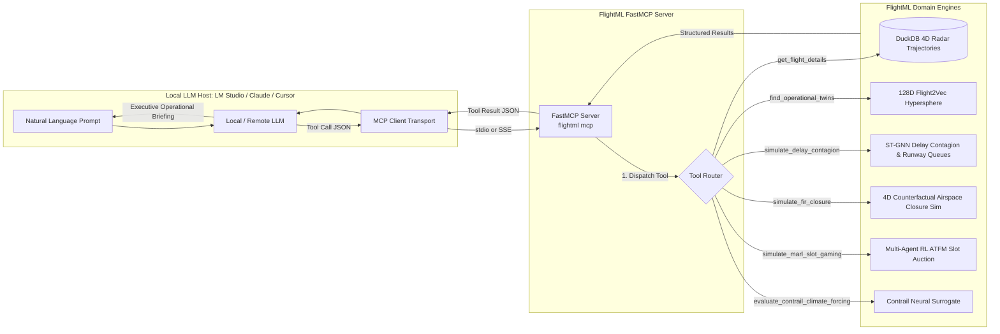

# FlightML Model Context Protocol (MCP) Server

FlightML provides a native **Model Context Protocol (MCP)** server built with the official Python `mcp` SDK (`FastMCP`). This exposes FlightML's DuckDB trajectory database, 128D Flight2Vec embeddings, Physics-Informed Neural Network (PINN) surrogates, Spatio-Temporal Graph WaveNet (ST-GNN) delay contagion engine, and Multi-Agent RL ATFM slot gaming simulator directly as callable tools to local and hosted Large Language Models (LLMs).

---

## 1. Supported MCP Hosts

You can connect FlightML to any MCP-compliant LLM runner:
- **LM Studio** (Desktop v0.3.5+ with native MCP support)
- **Claude Desktop**
- **Cursor IDE**
- **Antigravity / Gemini CLI**
- **Ollama** (via MCP bridges or Open WebUI)



---

## 2. Quickstart & Configuration

### A. Launching the MCP Server via CLI
You can test and run the FlightML MCP server directly from your terminal:

```bash
# Standard I/O mode (default for LM Studio and Claude Desktop)
flightml mcp

# Or via Python module directly
python -m flightml.mcp.server

# Server-Sent Events (SSE) mode for network/web clients
flightml mcp --transport sse --port 8000
```

---

### B. LM Studio Configuration

LM Studio (v0.3.5+) includes a visual MCP manager as well as a configuration file.

#### Option 1: Visual Configuration in LM Studio
1. Open LM Studio and go to **Settings** $\to$ **Tools & MCP**.
2. Click **Add Server**.
3. Fill in:
   - **Name**: `FlightML`
   - **Command**: `python`
   - **Arguments**: `-m flightml.mcp.server`
   - **Working Directory**: `c:\Projects\data\FlightML` (or your FlightML directory)
   - **Environment Variables**: `PYTHONPATH=c:\Projects\data\FlightML`

#### Option 2: Editing `mcp.json`
Add the following entry to your LM Studio MCP configuration file (located in `%USERPROFILE%\.cache\lm-studio\mcp.json` or through **Edit mcp.json** in the UI):

```json
{
  "mcpServers": {
    "flightml": {
      "command": "python",
      "args": [
        "-m",
        "flightml.mcp.server"
      ],
      "cwd": "c:\\Projects\\data\\FlightML",
      "env": {
        "PYTHONPATH": "c:\\Projects\\data\\FlightML"
      }
    }
  }
}
```

> [!TIP]
> **Recommended Local Models in LM Studio**:
> For optimal tool calling and JSON argument formatting, select:
> - **Qwen 2.5 14B / 32B Instruct** (GGUF Q4_K_M or Q8_0)
> - **Llama 3.1 / 3.3 8B or 70B Instruct**
> - **Mistral NeMo 12B Instruct**

---

### C. Claude Desktop Configuration

Edit `%APPDATA%\Claude\claude_desktop_config.json` on Windows (or `~/Library/Application Support/Claude/claude_desktop_config.json` on macOS):

```json
{
  "mcpServers": {
    "flightml": {
      "command": "python",
      "args": [
        "-m",
        "flightml.mcp.server"
      ],
      "cwd": "C:\\Projects\\data\\FlightML",
      "env": {
        "PYTHONPATH": "C:\\Projects\\data\\FlightML"
      }
    }
  }
}
```

---

### D. Cursor IDE Configuration

In Cursor, go to **Settings** $\to$ **Features** $\to$ **MCP Servers** $\to$ **Add New MCP Server**:
- **Name**: `flightml`
- **Type**: `command`
- **Command**: `python -m flightml.mcp.server`

---

## 3. Tool Reference Catalog

The FlightML MCP server exposes 8 specialized tools covering European air traffic operations:

### 1. `get_flight_details`
Retrieves verified 4D radar telemetry for a specific flight by its Eurocontrol unique identifier (`ectrl_id`).
- **Arguments**:
  - `flight_id` (*str | int*, required): Unique flight ID (e.g. `'291262156'`).
  - `period` (*str*, optional, default `'202510'`): Eurocontrol archive period.
- **Returns**: JSON object containing ADEP, ADES, aircraft type, operator, registration tail (`ac_reg`), stage distance, delays, flight level, and actual/filed timestamps.

### 2. `search_flights`
Filters scheduled and operated flights by destination, origin, operator code, and date.
- **Arguments**:
  - `ades` (*str*, optional, default `'EGLL'`): Arrival airport ICAO.
  - `adep` (*str*, optional): Departure airport ICAO.
  - `operator` (*str*, optional): Airline operator ICAO (e.g. `'BAW'`, `'DLH'`).
  - `date_str` (*str*, optional, default `'2025-10-15'`): Date (YYYY-MM-DD).
  - `limit` (*int*, optional, default `10`): Max results (1–50).
  - `period` (*str*, optional, default `'202510'`): Archive period.
- **Returns**: JSON list of candidate flights matching the operational query.

### 3. `find_operational_twins`
Searches the 128D Flight2Vec hypersphere space to find identical and near-identical operational twin flights.
- **Arguments**:
  - `flight_id` (*str | int*, required): Target flight identifier.
  - `top_k` (*int*, optional, default `5`): Number of twins to retrieve.
  - `period` (*str*, optional, default `'202510'`): Archive period.
- **Returns**: Cosine similarity scores ($\ge 0.98$), distance deltas, cruise flight level matches, and human-readable operational explanations for each match.

### 4. `simulate_delay_contagion`
Simulates spatio-temporal delay propagation from an airport disruption across European hubs using the Spatio-Temporal Graph WaveNet (ST-GNN) engine.
- **Arguments**:
  - `shock_origin` (*str*, optional, default `'EGLL'`): ICAO airport code.
  - `injected_delay_min` (*float*, optional, default `60.0`): Delay shock in minutes.
  - `shock_date` (*str*, optional, default `'2025-10-15'`): Event date.
  - `shock_time_hour` (*int*, optional, default `10`): UTC start hour (0–23).
  - `shock_duration_hours` (*float*, optional, default `2.0`): Event duration.
- **Returns**: Runway saturation %, spare recovery capacity, multi-horizon delay escalation matrix ($t=0\text{h}, 1\text{h}, 2\text{h}, 4\text{h}, 6\text{h}$), ranked downstream vulnerable hubs, and physical turnaround airframe rotations transmitting reactionary delays.

### 5. `simulate_fir_closure`
Models counterfactual tactical rerouting and economic disruption caused by a temporary Flight Information Region (FIR) closure.
- **Arguments**:
  - `target_fir` (*str*, optional, default `'LSASFIR'`): Closed FIR code (e.g. `'LSASFIR'`, `'EDUUUIR'`, `'LFFFFIR'`).
  - `closure_date` (*str*, optional, default `'2025-10-15'`): Date of closure.
  - `start_hour` (*int*, optional, default `10`): UTC start hour.
  - `duration_hours` (*float*, optional, default `3.0`): Duration of closure.
- **Returns**: Total flights impacted, rerouted flights count, detour nautical miles, extra fuel burned (tonnes), airline financial losses (€ EUR), and post-reopening bottleneck recovery backlog curve.

### 6. `simulate_marl_slot_gaming`
Runs a Multi-Agent Reinforcement Learning (MARL) Air Traffic Flow Management (ATFM) simulation modeling strategic slot gaming and Nash equilibrium.
- **Arguments**:
  - `regulated_airport` (*str*, optional, default `'EGLL'`): Bottleneck airport.
  - `capacity_cut_pct` (*float*, optional, default `40.0`): Capacity reduction %.
  - `regulation_date` (*str*, optional, default `'2025-10-15'`): Regulation date.
  - `start_hour` (*int*, optional, default `10`): Start hour (UTC).
  - `duration_hours` (*float*, optional, default `3.0`): Regulation duration.
  - `iterations` (*int*, optional, default `50`): Simulation iterations.
- **Returns**: 10-step chronological decision log, infilled domain assumptions (connecting passengers, load factors, EU261 exposure, EASA crew duty limits), and per-airline net gains/losses balance sheets in Euros (€ EUR).

### 7. `evaluate_contrail_climate_forcing`
Evaluates contrail formation and climate warming using a Physics-Informed Neural Network (PINN) surrogate.
- **Arguments**:
  - `temperature_c` (*float*, optional, default `-54.0`): Static air temperature (°C).
  - `rh_ice_pct` (*float*, optional, default `120.0`): Relative humidity over ice (%).
  - `flight_level` (*float*, optional, default `360.0`): Cruising altitude (FL).
  - `rh_water_pct` (*float*, optional, default `75.0`): Relative humidity over water (%).
  - `bypass_ratio` (*float*, optional, default `8.5`): Engine bypass ratio.
- **Returns**: Schmidt-Appleman criterion satisfaction, persistent ISSR formation, optical depth ($\tau$), instantaneous radiative forcing ($mW/m^2$), and climate forcing severity classification.

### 8. `get_airport_capacity`
Returns nominal hourly movement capacity and operational profile for a European airport.
- **Arguments**:
  - `airport_icao` (*str*, optional, default `'EGLL'`): 4-letter ICAO code.
- **Returns**: Nominal hourly movements and runway configuration profile.

---

## 4. Resources and Prompts

### Resources
- `flightml://assumptions/marl_glossary`: Detailed explanations of unobserved operational parameters infilled for raw DDR2 radar trajectories.
- `flightml://airports/{icao}/capacity`: Dynamic template returning nominal capacity for any European airport.

### Prompts
- `analyze_airport_delay_shock(airport, delay_min)`: Pre-engineered prompt template instructing the LLM to run an end-to-end delay contagion assessment and draft an executive briefing.

---

## 5. Example Dialogues in LM Studio

### Example A: Delay Shock Propagation
> **User**: *"We have a 60-minute delay shock at London Heathrow (EGLL) on October 15, 2025 at 10:00 UTC lasting 2 hours. What is the impact on European operations?"*

1. **LLM Calls Tool**: `simulate_delay_contagion(shock_origin='EGLL', injected_delay_min=60, shock_date='2025-10-15', shock_time_hour=10, shock_duration_hours=2)`
2. **Tool Returns**: 572 reactionary delay hours across 560 flights, 98.9% runway saturation, and key downstream hubs (`EHAM`, `LFPG`, `EDDF`).
3. **LLM Responds**:
   > *"Heathrow operates at 98.9% runway saturation during the morning peak, leaving less than 1 movement/hour of spare recovery buffer. Because departures and arrivals cannot outstrip runway capacity, the queue bottleneck persists for over 4 hours. The model forecasts +572 hours of total reactionary delay propagating across Europe, with Amsterdam Schiphol (+14.2h) and Paris CDG (+11.8h) absorbing the highest secondary impacts..."*

---

### Example B: Airspace Closure Counterfactual
> **User**: *"What happens if Swiss airspace (LSASFIR) closes for 3 hours starting at 10:00 UTC?"*

1. **LLM Calls Tool**: `simulate_fir_closure(target_fir='LSASFIR', start_hour=10, duration_hours=3.0)`
2. **Tool Returns**: 577 flights impacted, 280 tactical reroutes, 41,200 extra nautical miles, +210 tonnes Jet-A fuel burned, and €482,000 in direct airline losses.
3. **LLM Responds**:
   > *"Closing LSASFIR impacts 577 flights. 280 transiting flights must divert around French (LFFFFIR) and German (EDUUUIR) airspace, adding 41,200 nautical miles and €482,000 EUR in airline operating costs. Post-reopening recovery will take ~3.5 hours to clear the accumulated 72-flight ground holding backlog."*
