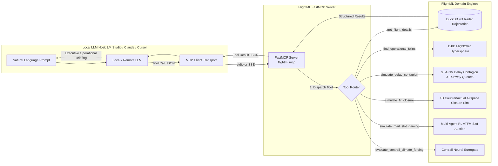

# FlightML Model Context Protocol (MCP) Server

FlightML provides a native **Model Context Protocol (MCP)** server built with the official Python `mcp` SDK (`FastMCP`). This exposes FlightML's DuckDB trajectory database, 128D Flight2Vec embeddings, Physics-Informed Neural Network (PINN) surrogates, Spatio-Temporal Graph WaveNet (ST-GNN) delay contagion engine, and Multi-Agent RL ATFM slot gaming simulator directly as callable tools to local and hosted Large Language Models (LLMs).

---

## 1. Supported MCP Hosts

You can connect FlightML to any MCP-compliant LLM runner:
- **LM Studio** (Desktop v0.3.5+ with native MCP support)
- **Claude Desktop**
- **Cursor IDE**
- **Antigravity / Gemini CLI**
- **Ollama** (via MCP bridges or Open WebUI)



---

## 2. Quickstart & Configuration

### A. Launching the MCP Server via CLI
You can test and run the FlightML MCP server directly from your terminal:

```bash
# Standard I/O mode (default for LM Studio and Claude Desktop)
flightml mcp

# Or via Python module directly
python -m flightml.mcp.server

# Server-Sent Events (SSE) mode for network/web clients
flightml mcp --transport sse --port 8000
```

---

### B. LM Studio Configuration

LM Studio (v0.3.5+) includes a visual MCP manager as well as a configuration file.

#### Option 1: Visual Configuration in LM Studio
1. Open LM Studio and go to **Settings** $\to$ **Tools & MCP**.
2. Click **Add Server**.
3. Fill in:
   - **Name**: `FlightML`
   - **Command**: `python`
   - **Arguments**: `-m flightml.mcp.server`
   - **Working Directory**: `c:\Projects\data\FlightML` (or your FlightML directory)
   - **Environment Variables**: `PYTHONPATH=c:\Projects\data\FlightML`

#### Option 2: Editing `mcp.json`
Add the following entry to your LM Studio MCP configuration file (located in `%USERPROFILE%\.cache\lm-studio\mcp.json` or through **Edit mcp.json** in the UI):

```json
{
  "mcpServers": {
    "flightml": {
      "command": "python",
      "args": [
        "-m",
        "flightml.mcp.server"
      ],
      "cwd": "c:\\Projects\\data\\FlightML",
      "env": {
        "PYTHONPATH": "c:\\Projects\\data\\FlightML"
      }
    }
  }
}
```

> [!TIP]
> **Recommended Local Models in LM Studio**:
> For optimal tool calling and JSON argument formatting, select:
> - **Qwen 2.5 14B / 32B Instruct** (GGUF Q4_K_M or Q8_0)
> - **Llama 3.1 / 3.3 8B or 70B Instruct**
> - **Mistral NeMo 12B Instruct**

---

### C. Claude Desktop Configuration

Edit `%APPDATA%\Claude\claude_desktop_config.json` on Windows (or `~/Library/Application Support/Claude/claude_desktop_config.json` on macOS):

```json
{
  "mcpServers": {
    "flightml": {
      "command": "python",
      "args": [
        "-m",
        "flightml.mcp.server"
      ],
      "cwd": "C:\\Projects\\data\\FlightML",
      "env": {
        "PYTHONPATH": "C:\\Projects\\data\\FlightML"
      }
    }
  }
}
```

---

### D. Cursor IDE Configuration

In Cursor, go to **Settings** $\to$ **Features** $\to$ **MCP Servers** $\to$ **Add New MCP Server**:
- **Name**: `flightml`
- **Type**: `command`
- **Command**: `python -m flightml.mcp.server`

---

## 3. Tool Reference Catalog

The FlightML FastMCP server exposes **35 specialized tools** returning structured JSON across European air traffic operations:

### A. Core Flight Telemetry & Twins
1. **`get_flight_details(flight_id, period)`**: Verified 4D radar telemetry (ADEP, ADES, type, operator, delays, FL, timestamps).
2. **`search_flights(ades, adep, operator, date_str, limit, period)`**: Query and filter flights matching operational criteria.
3. **`find_operational_twins(flight_id, top_k, period)`**: Retrieve nearest 128D Flight2Vec twin flights with cosine similarity ($\ge 0.98$) and domain explanations.

### B. Physics & Flight Efficiency (Eurocontrol PRU / ICAO GANP)
4. **`get_pru_scorecard(flight_id, period)`**: Full ICAO GANP & Eurocontrol PRU scorecard (KPI04 KEP en-route horizontal inefficiency, KPI05 KEA actual en-route inefficiency, tactical ATC shortcut delta, KPI08 ASMA 40 NM terminal arrival holding, and KPI19 cruise level-capping).
5. **`get_cdo_descent_profile(flight_id, period)`**: Continuous Descent Operations (CDO) compliance score, Top of Descent (TOD), low-altitude level segments (<10,000 ft), and noise/fuel penalties.
6. **`get_cco_climb_profile(flight_id, period)`**: Continuous Climb Operations (CCO) compliance score, departure SID level-offs, and climb profile efficiency.
7. **`get_fra_adherence(flight_id, period, direct_dct_tolerance_nm)`**: Free Route Airspace (FRA) adherence, DCT direct waypoint shortcuts, and mileage savings vs structured airway network.
8. **`diagnose_flight_bottlenecks(flight_id, period)`**: 360-degree bottleneck diagnostic: departure surface delay, en-route ATFM re-routing, arrival terminal holding, and weather attribution.

### C. Route Economics & Eurocontrol Charges (€ EUR)
9. **`get_flight_doc(flight_id, period, time_cost_eur_per_hr)`**: Total Direct Operating Cost ($\text{DOC} = \text{Fuel } € + \text{Crew/Time } € + \text{CRCO Charges } €$) and route charge avoidance incentive ratio (€/NM).
10. **`get_crco_charges(flight_id, period)`**: Eurocontrol Central Route Charges Office (CRCO) En-Route Navigation Charges in Euros (€ EUR), Service Units ($d \times w$), distance factor, weight factor, and FIR billing zones.
11. **`scan_route_charge_avoidance(period, min_flights, detour_nm_threshold, fee_saved_threshold_eur, limit)`**: Scan European network city pairs for systematic FIR route charge avoidance detours.
12. **`get_fuel_and_emissions(flight_id, period, jet_a_price_eur_per_kg)`**: OpenAP kinematic fuel burn, ICAO engine emissions ($\text{CO}_2$, $\text{NO}_x$), and Jet-A expenditure in Euros (€ EUR).
13. **`get_jet_fuel_prices(period)`**: Weekly European Jet-A spot fuel prices from IATA / Platts benchmarks in Euros (€/kg, €/tonne).

### D. Airspace, FIR Sectors & Conflicts
14. **`get_fir_saturation(fir_id, date, period, threshold_pct, limit)`**: Hourly FIR airspace entry volume, capacity limits, peak utilization %, and ATFM delay severity.
15. **`get_flight_fir_dwell(flight_id, period)`**: Flight-level sector-by-sector entry/exit timestamps, dwell durations, and dwell inefficiency delays.
16. **`get_fra_boundary_rankings(period, min_flights, limit, cross_border_only)`**: Analyze European FIR boundary Free Route Airspace (FRA) routing inefficiencies, detect active cross-border Free Route Airspace implementations, and rank boundaries in descending order of priority for FRA rollout.
17. **`diagnose_fra_boundary(boundary_pair, period)`**: Detailed operational diagnostic for an individual FIR boundary interface (e.g. `EGTTUIR <-> LFFFUIR`), including directional flow balance, 24-hour diurnal crossing congestion profile, and top impacted airlines.
18. **`get_fra_worst_flights(boundary_pair, period, limit, max_distance_nm)`**: List the most detoured flights across a specific boundary interface vs direct Free Route Airspace geodesic benchmarks.
19. **`forecast_fra_benefits(period, year_baseline, baseline_mode, use_seasonal_synthesis, annual_growth_rate_pct, realization_rate_pct, scope, jet_a_price_eur_per_kg)`**: Multi-horizon long-term forecast (1, 5, 20 years) of accumulated crossings, detour NM avoided, Jet-A fuel conserved, CO₂ mitigated, and direct operating cost savings strictly in Euros (€ EUR). Supports both 12-month contiguous empirical baseline (`baseline_mode="full_year"`) and 3-season synthesis.
20. **`locate_fir(lat, lon, flight_level)`**: Determine which European FIR/UIR airspace sector contains a given 3D/4D coordinate.
21. **`scan_airspace_conflicts(date, hour, horiz_nm, vert_fl, period, limit)`**: Scan European airspace for 4D radar proximity events (<5 NM, <1000 ft) and sector complexity index.
22. **`estimate_radio_workload(airport_icao, date, period)`**: ATC VHF radio frequency transmission workload, peak communications load, and channel occupancy.

### E. Airport Surface & Safety
23. **`get_airport_taxi_out(airport_icao, date, period, min_flights, limit)`**: Airport surface taxi-out performance: unimpeded baseline duration (UTOT p20) vs actual off-block to takeoff time and excess queue delays (ATOT).
24. **`get_flight_taxi_out(flight_id, period)`**: Single-flight taxi-out surface duration, unimpeded reference, excess minutes, and ICAO EDB v32B LTO idle emissions.
25. **`calculate_runway_winds(airport, wind_dir, wind_speed, gust)`**: Headwind, crosswind, and tailwind components for all available runways at an airport.
26. **`assess_runway_safety(flight_id, period)`**: Runway safety & operational wind limits: crosswind/tailwind limits, wet runway braking action code, and stopping distance margin.
27. **`get_airport_capacity(airport_icao)`**: Nominal hourly runway movement capacity and operational profile.

### F. Network Contagion, Swaps & Simulations
28. **`simulate_delay_contagion(shock_origin, injected_delay_min, shock_date, shock_time_hour, shock_duration_hours)`**: Spatio-Temporal Graph WaveNet (ST-GNN) delay propagation simulation across European hubs.
29. **`simulate_fir_closure(target_fir, closure_date, start_hour, duration_hours)`**: Counterfactual tactical rerouting, detour nautical miles, extra fuel burn, and airline losses from closed airspace sectors.
30. **`simulate_marl_slot_gaming(regulated_airport, capacity_cut_pct, regulation_date, start_hour, duration_hours, iterations)`**: Multi-Agent Reinforcement Learning (MARL) ATFM slot gaming and strategic airline auctioning.
31. **`analyze_reactionary_delay(operator, start_date, end_date, period)`**: Rotational airframe delay propagation, turnaround buffer slack absorption, and downstream reactionary multiplier.
32. **`optimize_tail_swaps(operator, airport_icao, date, period)`**: Hub tail swap optimizer to break reactionary delay chains and preserve connecting passengers.
33. **`evaluate_contrail_climate_forcing(temperature_c, rh_ice_pct, flight_level, rh_water_pct, bypass_ratio)`**: Schmidt-Appleman criterion, persistent contrail ISSR formation, and radiative forcing ($mW/m^2$).

### G. Predictive ML & Passenger Copilot
34. **`predict_flight_delay(adep, ades, operator, market_segment, requested_fl, distance_nm, hour, day_of_week)`**: Gradient-boosted ML delay predictor estimating arrival delay minutes and risk level.
35. **`assess_passenger_itinerary(origin, destination, hub, day_of_week, time_window, scheduled_layover_min, target_date, period, debug)`**: Multi-leg journey risk, transfer hub missed connection probability (MCT buffer vs weather), Heathrow T5 20m gate conformance cutoff, EU261/UK261 compensation rights (€250–€600), and departure wave optimization.

---

## 4. Resources and Prompts

### Resources
- `flightml://assumptions/marl_glossary`: Detailed explanations of unobserved operational parameters infilled for raw DDR2 radar trajectories.
- `flightml://airports/{icao}/capacity`: Dynamic template returning nominal capacity for any European airport.

### Prompts
- `analyze_airport_delay_shock(airport, delay_min)`: Pre-engineered prompt template instructing the LLM to run an end-to-end delay contagion assessment and draft an executive briefing.

---

## 5. Example Dialogues in LM Studio

### Example A: Delay Shock Propagation
> **User**: *"We have a 60-minute delay shock at London Heathrow (EGLL) on October 15, 2025 at 10:00 UTC lasting 2 hours. What is the impact on European operations?"*

1. **LLM Calls Tool**: `simulate_delay_contagion(shock_origin='EGLL', injected_delay_min=60, shock_date='2025-10-15', shock_time_hour=10, shock_duration_hours=2)`
2. **Tool Returns**: 572 reactionary delay hours across 560 flights, 98.9% runway saturation, and key downstream hubs (`EHAM`, `LFPG`, `EDDF`).
3. **LLM Responds**:
   > *"Heathrow operates at 98.9% runway saturation during the morning peak, leaving less than 1 movement/hour of spare recovery buffer. Because departures and arrivals cannot outstrip runway capacity, the queue bottleneck persists for over 4 hours. The model forecasts +572 hours of total reactionary delay propagating across Europe, with Amsterdam Schiphol (+14.2h) and Paris CDG (+11.8h) absorbing the highest secondary impacts..."*

---

### Example B: Airspace Closure Counterfactual
> **User**: *"What happens if Swiss airspace (LSASFIR) closes for 3 hours starting at 10:00 UTC?"*

1. **LLM Calls Tool**: `simulate_fir_closure(target_fir='LSASFIR', start_hour=10, duration_hours=3.0)`
2. **Tool Returns**: 577 flights impacted, 280 tactical reroutes, 41,200 extra nautical miles, +210 tonnes Jet-A fuel burned, and €482,000 in direct airline losses.
3. **LLM Responds**:
   > *"Closing LSASFIR impacts 577 flights. 280 transiting flights must divert around French (LFFFFIR) and German (EDUUUIR) airspace, adding 41,200 nautical miles and €482,000 EUR in airline operating costs. Post-reopening recovery will take ~3.5 hours to clear the accumulated 72-flight ground holding backlog."*

---

## 6. Real-World LM Studio Conversation Transcript

For an exported multi-turn session transcript showing `qwen/qwen2.5-coder-14b` querying EHAM $\to$ EGLL flights, computing punctuality statistics, and tabulating records without hallucination, see:
- 📖 [**Full LM Studio + Qwen 2.5 Coder 14B Transcript**](mcp_example_lmstudio.md)
