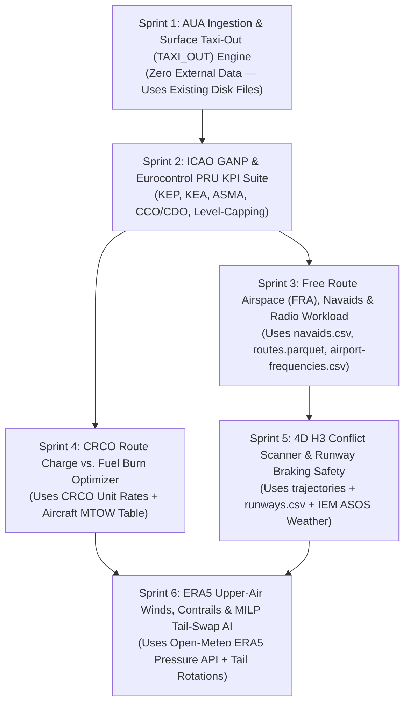

# FlightML v2.0 — Implementation Plan, Rationale & Data Acquisition Blueprint 🗺️

This document serves as the **executable engineering blueprint and resumption guide** for **FlightML v2.0**. It structures the scientific and operational rationale for each planned capability, catalogs **what data is already on disk vs. what external data is required (and exactly where to obtain it)**, and breaks the implementation into **6 self-contained sprints** with exact file paths, function signatures, CLI commands, API routes, and verification tests.

---

> [!IMPORTANT]
> ### 🔒 Data Access & Eurocontrol OneSky Online Compliance Notice
> Any Eurocontrol Demand Data Repository (DDR2 / PRISME / R-NEST) files referenced in this blueprint require an active institutional research account on **Eurocontrol's OneSky Online portal** ([https://www.eurocontrol.int/](https://www.eurocontrol.int/)) and must remain excluded from Git via [`.gitignore`](file:///C:/Projects/data/FlightML/.gitignore). Only open-access reference tables (e.g., public CRCO unit rates, OpenAP aircraft parameters, OurAirports catalogs) may be committed to the repository.

---

## 1. Data Inventory & External Data Acquisition Matrix

Before writing code for v2.0, every feature is mapped to its required data inputs across **three tiers**:
1. **Tier 1 (Zero External Data Needed)**: Already present in `data/` or `data/extracted/202510/` on disk, awaiting ingestion or query integration.
2. **Tier 2 (Free Open-Access Public Data / Zero-Key APIs)**: Publicly downloadable reference tables or keyless REST APIs that can be fetched automatically or bundled in `data/`.
3. **Tier 3 (Optional Institutional / Portal Data)**: Supplemental Eurocontrol ANS Performance or Copernicus datasets for advanced validation.

### 1.1 Tier 1 — Untapped Data Already on Disk (`C:\Projects\data\FlightML\data\`)

| Local Path on Disk | Size / Rows | Schema Columns | Target v2.0 Feature |
| :--- | :--- | :--- | :--- |
| `data/extracted/202510/Flight_AUAs_Actual_20251001_20251031.csv.gz` | 84.0 MB | `"ECTRL ID", "Sequence Number", "AUA ID", "Entry Time", "Exit Time"` | **Sprint 1 & 2**: ATC Unit Airspace (`*TMA`, `*CTA`, `*UTA`) bottlenecks & ICAO KPI08 (ASMA Terminal Transit Time) |
| `data/extracted/202510/Flight_AUAs_Filed_20251001_20251031.csv.gz` | 78.0 MB | `"ECTRL ID", "Sequence Number", "AUA ID", "Entry Time", "Exit Time"` | **Sprint 1 & 2**: Planned vs. Actual TMA/CTA dwell inefficiency & ATC re-routing detection |
| `data/parquet/periods/202510/flight_firs_actual.parquet` (`FIR ID = 'TAXI_OUT'`) | Sequence `0` of all flights | `ectrl_id, seq_num, fir_id, entry_time, exit_time, dwell_min` | **Sprint 1 & 2**: ICAO KPI02 Additional Taxi-Out Time (ATOT), departure queue lengths & ground APU/idle fuel burn |
| `data/parquet/periods/202510/flight_firs_actual.parquet` (`*FIR` vs `*UIR`) | ~14M traversal rows | `fir_id` ending in `FIR` (Lower) vs `UIR` (Upper) | **Sprint 2**: Vertical airspace layer dwell analysis & flight-level capping attribution |
| [`data/navaids.csv`](file:///C:/Projects/data/FlightML/data/navaids.csv) / `data/parquet/navaids.parquet` | 11,008 rows | `ident, name, type, frequency_khz, latitude_deg, longitude_deg, usageType, power, associated_airport` | **Sprint 3**: Free Route Airspace (FRA) vs. conventional VOR/DME/NDB beacon adherence |
| [`data/airport-frequencies.csv`](file:///C:/Projects/data/FlightML/data/airport-frequencies.csv) / `airport_frequencies.parquet` | 30,393 rows | `airport_ident, type (TWR/GND/APP/DEP/ATIS), description, frequency_mhz` | **Sprint 3**: ATC radio channel density & controller-pilot voice workload estimation |
| `data/extracted/202510/Route_2509.csv.gz`, `Route_2510.csv.gz`, `Route_2511.csv.gz` | 3 $\times$ 1.38 MB | `"Route ID", "Sequence Number", "Latitude", "Longitude"` | **Sprint 3**: Multi-cycle airway snapping & post-AIRAC airline adaptation speed |
| `data/extracted/202510/FIR_2509.csv.gz`, `FIR_2510.csv.gz`, `FIR_2511.csv.gz` | 3 $\times$ 504 KB | `"Airspace ID", "Min Flight Level", "Max Flight Level", "Sequence Number", "Latitude", "Longitude"` | **Sprint 3**: 3D vertical sector boundary slicing across contiguous AIRAC cycles |
| [`data/runways.csv`](file:///C:/Projects/data/FlightML/data/runways.csv) / `data/parquet/runways.parquet` | 48,405 rows | `airport_ident, length_ft, width_ft, surface, lighted, closed, le_elevation_ft, le_displaced_threshold_ft, le_heading_degT` | **Sprint 5**: Density-altitude takeoff/landing field length margin & wet/contaminated runway braking risk |

---

### 1.2 Tier 2 — Additional External Data Needed & Exact Sources

Where features require physical, economic, or atmospheric parameters beyond what is currently in `data/`, the table below specifies **what is needed, where to get it for free, and how FlightML will ingest it**:

| Required Dataset | Why It Is Needed | Exact Source & URL | Access Method & License | Target Storage Path |
| :--- | :--- | :--- | :--- | :--- |
| **1. Eurocontrol CRCO En-Route Unit Rates ($U_i$) & Exchange Rates** | Needed for **Sprint 4** to compute national ATC route navigation charges ($\text{EUR}$) per FIR/Charging Zone for both historical (`201611`) and modern (`202510`) periods. | **Eurocontrol Central Route Charges Office (CRCO)**:<br/>• Public Monthly Adjusted Unit Rates: `https://www.eurocontrol.int/crco#key-documents`<br/>• ANS Performance Data Portal (Route Charges Table): `https://ansperformance.eu/economics/cba/` | **Public / Open Access** (No login required; static reference table of ~42 European charging zones for Nov 2016 and Oct 2025). | `data/crco/crco_unit_rates.csv` (Commit to Git, ~4 KB) |
| **2. Aircraft $\text{MTOW}$, Wake Category & OpenAP Performance Table** | Needed for **Sprint 2, 4 & 5**: CRCO charges scale by $\sqrt{\text{MTOW}/50}$; runway braking risk and climb/descent physics depend on aircraft $\text{MTOW}$, wing area, and wake turbulence category (`L`, `M`, `H`, `J`). | **TU Delft OpenAP** (Open Aircraft Performance Model):<br/>• GitHub CSV/YAML Catalog: `https://github.com/junzis/openap/tree/master/openap/data/aircraft`<br/>• ICAO DOC 8643 Aircraft Type Designators | **Public / GNU GPLv3 / Open Data** (Installable via `pip install openap` or bundled as a clean lookup CSV for the top 150 `ac_type` codes in `flights`). | `data/aircraft/aircraft_performance_mtow.csv` (Commit to Git, ~15 KB) |
| **3. ICAO Engine Emissions Databank (EEDB) LTO & Cruise Indices** | Needed for **Sprint 1 & 2** to expand environmental reporting beyond $\text{CO}_2$ ($3.16\text{ kg/kg}$) to include $\text{NO}_x$, $\text{SO}_x$, $\text{CO}$, $\text{HC}$, and non-volatile Particulate Matter ($\text{nvPM}$) during Taxi-Out (`TAXI_OUT`), Climb, Cruise, and Approach. | **EASA / ICAO Aircraft Engine Emissions Databank**:<br/>• `https://www.easa.europa.eu/en/domains/environment/icao-aircraft-engine-emissions-databank` | **Public / Open Access** (Standard fuel-flow and emission indices $\text{EI}_{\text{NOx}}, \text{EI}_{\text{CO}}, \text{EI}_{\text{HC}}$ in $\text{g/kg}$ fuel for Taxi/Idle 7%, Approach 30%, Climb 85%, Take-Off 100%). | `data/aircraft/icao_emissions_indices.csv` (Commit to Git, ~10 KB) |
| **4. Gridded Upper-Air Winds ($u, v$), Temperature ($T$) & Relative Humidity ($\text{RHi}$) at Pressure Levels ($200\text{–}300\text{ hPa}$)** | Needed for **Sprint 6**:<br/>1) Separating Jet Stream wind-optimal routing from ATC vectoring.<br/>2) Identifying Ice Supersaturated Regions ($\text{RHi} > 100\%, T < -40^\circ\text{C}$) for contrail cirrus prediction. | **Option A (Zero-Key REST API — Recommended for On-Demand)**:<br/>• **Open-Meteo Historical Pressure-Level API** (ERA5-backed): `https://archive-api.open-meteo.com/v1/archive` (supports geopotential height, wind speed/direction, temperature, and relative humidity at `300hPa`, `250hPa`, `200hPa` corresponding to FL300, FL340, FL390).<br/>**Option B (Bulk NetCDF/Zarr)**:<br/>• Google Cloud Public ERA5 Zarr: `gs://gcp-public-data-arco-era5/ar/full_37-1h-0p25deg-chunk-1.zarr-v3`<br/>• Copernicus CDS (`cdsapi` package). | **Public / Free Open API** (Open-Meteo requires **no API key** for non-commercial research and caches locally just like `MetarClient` in `flightml/weather/metar_client.py`). | Cached on demand in `data/weather/upper_air_cache.parquet` (Ignored by Git) |
| **5. Public Airport/En-Route ATFM Delay Cause Reference (Optional Validation)** | Needed to cross-check FlightML's inferred weather/capacity bottlenecks against official Network Manager delay reason codes (`C` ATC Capacity, `S` Staffing, `W` Weather). | **Eurocontrol ANS Performance Open Data**:<br/>• `https://ansperformance.eu/data/` (`apt_dly` and `ert_dly` open Parquet/CSV files). | **Public / Open Access** (Downloadable directly from Eurocontrol PRU open portal without OneSky credentials). | `data/reference/ansp_atfm_benchmarks.csv` (Optional) |

---

## 2. Detailed Sprint-by-Sprint Rationale & Implementation Plan



---

### Sprint 1: ATC Unit Airspaces (`AUA`) Ingestion & Surface Taxi-Out (`TAXI_OUT`) Engine

#### Rationale
1. **Why AUAs**: Flight Information Regions (FIRs) follow national borders, whereas air traffic control actually happens inside **ATC Unit Airspaces (AUAs)**—Terminal Maneuvering Areas (`*TMA`), Control Areas (`*CTA`), and Upper Control Areas (`*UTA`). `data/extracted/202510/` already contains `Flight_AUAs_Actual_20251001_20251031.csv.gz` (84 MB) and `Flight_AUAs_Filed_20251001_20251031.csv.gz` (78 MB), which are currently skipped by `EurocontrolArchiveIngestor.classify_files()`.
2. **Why `TAXI_OUT`**: Sequence `0` in `flight_firs_actual.parquet` records the exact off-block to takeoff (`TAXI_OUT`) duration for every flight, alongside its filed counterpart in `flight_firs_filed.parquet`. Right now `fir_saturation.py` filters `WHERE fir_id != 'TAXI_OUT'`, discarding a goldmine of airport surface congestion and ground fuel burn data.

#### Implementation Tasks
1. **Update [`flightml/data/archive_ingest.py`](file:///C:/Projects/data/FlightML/flightml/data/archive_ingest.py)**:
   - In `classify_files()`, add classification rules for:
     - `"flight_auas_actual" in name` $\to$ `classified["flight_auas_actual"] = f`
     - `"flight_auas_filed" in name` $\to$ `classified["flight_auas_filed"] = f`
   - Convert both into `data/parquet/periods/202510/flight_auas_actual.parquet` and `flight_auas_filed.parquet`.
2. **Update [`flightml/data/dataset.py`](file:///C:/Projects/data/FlightML/flightml/data/dataset.py)**:
   - Register DuckDB views `flight_auas_actual` and `flight_auas_filed` (with `aua_id`, `aua_type` inferred via `CASE WHEN aua_id LIKE '%TMA' THEN 'TMA' WHEN aua_id LIKE '%UTA' THEN 'UTA' WHEN aua_id LIKE '%CTA' THEN 'CTA' ELSE 'OTHER' END`, `entry_time`, `exit_time`, `dwell_min`).
3. **Create `flightml/features/aua_saturation.py`**:
   - `calculate_aua_hourly_saturation(ds, aua_type="TMA", threshold_flights_per_hr=30, top_n=20)`
   - `calculate_flight_aua_dwell_inefficiency(ds, ectrl_id)`
4. **Create `flightml/eval/surface_taxi.py`**:
   - `analyze_airport_taxi_out_performance(ds, airport_icao=None, top_n=20) -> TaxiOutReport`:
     - Computes **Unimpeded Taxi-Out Time (UTOT)** as the 20th percentile of actual `TAXI_OUT` durations per `(adep, ac_type)`.
     - Computes **Additional Taxi-Out Time (ATOT = Actual - UTOT)** (ICAO KPI02).
     - Computes ground idle/APU fuel burn ($\text{kg}$), $\text{CO}_2$, $\text{NO}_x$, $\text{CO}$, $\text{HC}$ emissions, and weekly spot fuel cost wasted in departure queues.
5. **CLI & API Additions**:
   - CLI: `flightml aua-saturation`, `flightml taxi-out --airport EGLL --period 202510`
   - REST: `GET /api/v1/aua/saturation`, `GET /api/v1/airports/{ident}/taxi-out`
   - Tests: `tests/test_aua_and_taxi.py`

---

### Sprint 2: ICAO GANP & Eurocontrol PRU Standard KPI Suite (KEP, KEA, ASMA, CCO/CDO, Level-Capping)

#### Rationale
Airlines, ANSPs, and Eurocontrol's Performance Review Unit (PRU) evaluate airspace performance using standardized ICAO GANP Key Performance Indicators. Currently, FlightML measures total origin-to-destination detour ratio and arrival CDO. However, an aircraft detour inside the 40 nm terminal maneuvering cylinder is an **airport terminal sequencing issue (ASMA — KPI08)**, whereas a detour outside 40 nm is an **en-route design (KEP — KPI04)** or **en-route tactical ATC (KEA — KPI05)** issue. Furthermore, vertical inefficiency occurs not just during descent (CDO), but also during **departure climb (CCO — KPI17)** and **cruise flight-level capping (KPI19)**.

#### Implementation Tasks
1. **Create `flightml/eval/pru_kpis.py`**:
   - `compute_flight_pru_kpis(ds, ectrl_id: int) -> PRUFlightScorecard`:
     - **KPI04 (KEP)**: Horizontal En-Route Inefficiency of the Filed Trajectory (`trajectory_planned` clipped outside 40 nm of `ADEP`/`ADES` vs. Achieved Distance).
     - **KPI05 (KEA)**: Horizontal En-Route Inefficiency of the Actual Trajectory (`trajectory_actual` clipped outside 40 nm vs. Achieved Distance).
     - **Tactical Shortcut / Vectoring Delta ($\text{KEA} - \text{KEP}$)**: Negative when ATC grants direct shortcuts; positive when ATC vectors the aircraft off-plan.
     - **KPI08 (ASMA Additional Time)**: Transit time inside the 40 nm / 100 nm arrival cylinder (and `*TMA` AUA dwell) minus unimpeded 20th-percentile transit time for that `(ades, arrival_sector, ac_type)`.
     - **KPI19 (Cruise Level-Capping & Lower/Upper FIR/UIR Split)**: Compares actual max cruise FL (`MAX(flight_level)` in `trajectory_actual`) against `flights.requested_fl`, and measures unexpected dwell time inside lower `*FIR` sectors when `*UIR` was filed.
   - `compute_network_pru_scorecard(ds, operator=None, fir_id=None) -> dict`
2. **Extend [`flightml/eval/cdo_analyzer.py`](file:///C:/Projects/data/FlightML/flightml/eval/cdo_analyzer.py)**:
   - Add `analyze_cco_climb(ds, ectrl_id: int) -> CCOReport` (Continuous Climb Operations from takeoff to Top of Climb `TOC`, detecting climb level-offs $<300\text{ ft/min}$ below cruise altitude and excess climb fuel penalty).
   - Add `analyze_vertical_profile_efficiency(ds, ectrl_id: int)` combining **CCO + Cruise Level-Capping + CDO**.
3. **CLI & API Additions**:
   - CLI: `flightml pru-scorecard <ectrl_id>`, `flightml cco-climb <ectrl_id>`, `flightml level-capping --period 202510`
   - REST: `GET /api/v1/flights/{ectrl_id}/pru-kpis`, `GET /api/v1/flights/{ectrl_id}/cco`
   - Tests: `tests/test_pru_kpis.py`

---

### Sprint 3: Free Route Airspace (FRA), Navaid/Airway Snapping & Radio Frequency Workload

#### Rationale
[`data/navaids.csv`](file:///C:/Projects/data/FlightML/data/navaids.csv) (11,008 radio navigation aids), [`data/airport-frequencies.csv`](file:///C:/Projects/data/FlightML/data/airport-frequencies.csv) (30,393 frequencies), and `routes.parquet` (`Route_2509`, `Route_2510`, `Route_2511`) are already committed and loaded as DuckDB views (`raw_navaids`, `raw_frequencies`, `raw_routes`), but no analytical module queries them yet. Between 2016 and 2025, European airspace underwent a massive transition from conventional VOR/airway routing to **Free Route Airspace (FRA)**.

#### Implementation Tasks
1. **Create `flightml/geo/fra_analyzer.py`**:
   - `analyze_flight_fra_adherence(ds, ectrl_id: int, snap_tolerance_nm: float = 2.5) -> FRAReport`:
     - Matches each 4D waypoint in `trajectory_actual` and `trajectory_planned` against `raw_navaids` (`VOR`, `VOR-DME`, `VORTAC`, `NDB`) and `raw_routes` airway segments.
     - Quantifies the **Free Route Airspace (FRA) Directness Index**: percentage of en-route distance flown via off-airway direct (`DCT`) segments vs. structured ATS airways.
   - `compare_fra_evolution(p1="201611", p2="202510")`:
     - Compares FRA adoption across European FIRs between November 2016 and October 2025.
2. **Create `flightml/features/radio_workload.py`**:
   - `estimate_airport_and_sector_radio_workload(ds, airport_icao: str)`:
     - Queries `raw_frequencies` (`TWR`, `GND`, `APP`, `DEP` channel counts for `airport_icao`) and divides peak hourly movements (`TAXI_OUT`, TMA entries/exits) by available discrete VHF channels to estimate **Controller-Pilot Communications Occupancy & Frequency Saturation**.
3. **CLI & API Additions**:
   - CLI: `flightml fra-analysis <ectrl_id>`, `flightml radio-workload --airport EGLL`
   - REST: `GET /api/v1/flights/{ectrl_id}/fra`, `GET /api/v1/airports/{ident}/radio-workload`
   - Tests: `tests/test_fra_and_radio.py`

---

### Sprint 4: Airspace Economics — Eurocontrol CRCO Route Charges vs. Fuel Burn Optimizer

#### Rationale
Airlines do not optimize flights for minimum fuel burn alone; they optimize **Total Direct Operating Cost ($\text{DOC}$)**, which balances **Jet-A fuel cost** against **Eurocontrol Central Route Charges Office (CRCO) navigation fees** and **crew/maintenance time cost**. Because CRCO unit rates ($U_i$) vary by up to $4\times$ between adjacent European states, airlines sometimes file longer routes around high-unit-rate FIRs—burning extra Jet-A fuel and emitting extra $\text{CO}_2$ to save money on ATC route charges.

#### Data Preparation
- Create `data/crco/crco_unit_rates.csv` containing official public Eurocontrol CRCO unit rates (in EUR) for European FIR Charging Zones across `201611` and `202510`.
- Create `data/aircraft/aircraft_performance_mtow.csv` containing standard OpenAP/ICAO $\text{MTOW}$ (metric tons), wake category, and weight factor $\sqrt{\text{MTOW}/50}$ for common ICAO `ac_type` codes (`B738`, `A320`, `A20N`, `A21N`, `B38M`, `B772`, `B77W`, `B789`, `A359`, `A388`, `E190`, etc.).

#### Implementation Tasks
1. **Create `flightml/eval/crco_economics.py`**:
   - `compute_flight_crco_charges(ds, ectrl_id: int) -> CRCOChargeReport`:
     - Computes distance $d_i$ (in km) flown inside each FIR Charging Zone from `flight_firs_actual` and `flight_firs_filed` + `trajectory_actual`.
     - Applies the official Eurocontrol formula:
       $$\text{Charge}_i = U_i \times \frac{d_i}{100} \times \sqrt{\frac{\text{MTOW}_{\text{tons}}}{50}}$$
     - Combines CRCO charges with weekly EIA fuel cost from [`compute_flight_fuel_and_emissions`](file:///C:/Projects/data/FlightML/flightml/eval/fuel_carbon.py) to report **Total Route Cost ($\text{Fuel USD} + \text{CRCO Nav Charges USD}$)**.
   - `detect_route_charge_avoidance(ds, adep: str, ades: str, ac_type: str)`:
     - Compares filed/actual trajectories on a city pair to flag flights that detoured around expensive FIRs at the expense of higher $\text{CO}_2$ emissions.
2. **CLI & API Additions**:
   - CLI: `flightml crco-cost <ectrl_id>`, `flightml route-economics --adep EGLL --ades LTFM --ac A321`
   - REST: `GET /api/v1/flights/{ectrl_id}/crco-cost`
   - Tests: `tests/test_crco_economics.py`

---

### Sprint 5: 4D Safety (Co-Altitude Proximity & Complexity Scanner) & Runway Braking Risk

#### Rationale
1. **Airspace Safety & Complexity**: Simple hourly flight entry counts (`fir_saturation.py`) do not capture whether 40 aircraft in a sector are safely separated in a single one-way flow or crossing at converging angles at the same Flight Level.
2. **Runway Safety**: [`data/runways.csv`](file:///C:/Projects/data/FlightML/data/runways.csv) provides exact runway physical dimensions (`length_ft`, `width_ft`, `surface`, `le_elevation_ft`, `le_displaced_threshold_ft`), which when combined with IEM ASOS weather (`tmpf`, `alti`, `gust`, `wxcodes`) allow physical assessment of landing/takeoff safety margins.

#### Implementation Tasks
1. **Create `flightml/geo/conflict_scanner.py`**:
   - `scan_airspace_proximity_events(ds, fir_id: str, date_str: str, hour: int, horiz_sep_nm: float = 5.0, vert_sep_fl: float = 10.0) -> ProximityReport`:
     - Uses DuckDB spatial-temporal binning on `trajectory_actual` (`time_over`, `latitude`, `longitude`, `flight_level`) to find co-altitude aircraft pairs passing within `horiz_sep_nm` and `vert_sep_fl` (1,000 ft), classifying geometry into **Crossing**, **Converging**, **Same-Track Trailing**, or **Opposite-Direction**.
   - `compute_sector_complexity_index(ds, fir_id: str, date_str: str)`:
     - Computes Eurocontrol Dynamic Density / Complexity score weighting vertical transitions (climb/descent points) and track angle entropy.
2. **Create `flightml/weather/runway_safety.py`**:
   - `assess_flight_runway_safety(ds, metar_client, ectrl_id: int) -> RunwaySafetyReport`:
     - Computes airport **Pressure Altitude** and **Density Altitude** from runway elevation (`le_elevation_ft`), METAR altimeter (`alti`), and temperature (`tmpf`).
     - Infers runway surface condition (**Dry**, **Wet**, **Snow/Ice Contaminated**) from METAR `wxcodes` (`RA`, `+RA`, `SN`, `FZRA`, `FG`).
     - Evaluates required landing/takeoff distance factor vs. available runway length (`length_ft - displaced_threshold_ft`) and crosswind/tailwind limits for the aircraft's wake/approach speed category.
3. **CLI & API Additions**:
   - CLI: `flightml conflict-scan --fir LTBBFIR --date 2025-10-01 --hour 14`, `flightml runway-safety <ectrl_id>`
   - REST: `GET /api/v1/airspace/conflicts`, `GET /api/v1/flights/{ectrl_id}/runway-safety`
   - Tests: `tests/test_safety_and_conflicts.py`

---

### Sprint 6: Upper-Air Physics (ERA5 Winds & Contrail ISSR Avoidance) + Prescriptive Tail-Swap AI

#### Rationale
1. **Upper-Air Winds & Contrails**: A transatlantic flight (`EGLL` $\to$ `KORD`) flying 150 nm north of the Great Circle is often riding a favorable Jet Stream rather than suffering ATC inefficiency. Conversely, cruising through an **Ice Supersaturated Region (ISSR)** ($\text{RHi} > 100\%, T < -40^\circ\text{C}$) forms persistent contrail cirrus whose radiative forcing can exceed the flight's entire $\text{CO}_2$ footprint. Using the **free, zero-key Open-Meteo Historical ERA5 Pressure-Level API**, FlightML can fetch upper-air wind ($u, v$), temperature ($T$), and relative humidity ($\text{RH}$) along any 4D trajectory on demand.
2. **Prescriptive Tail-Swap Optimizer**: [`reactionary_delay.py`](file:///C:/Projects/data/FlightML/flightml/models/reactionary_delay.py) currently diagnoses how a delayed inbound aircraft infects downstream legs. By formulating a bipartite matching / Mixed-Integer Linear Program (MILP) across same-type (`ac_type`) aircraft tails (`ac_reg`) of the same operator (`ac_operator`) on the ground at a hub airport, FlightML can recommend **exact tail swaps** to absorb inbound delays and minimize total downstream passenger delay minutes.

#### Implementation Tasks
1. **Create `flightml/weather/upper_air_client.py`**:
   - `UpperAirClient`: Queries `https://archive-api.open-meteo.com/v1/archive` for pressure levels `300hPa` (~FL300), `250hPa` (~FL340), and `200hPa` (~FL390) (`temperature_250hPa`, `relative_humidity_250hPa`, `wind_speed_250hPa`, `wind_direction_250hPa`) with local Parquet caching in `data/weather/upper_air_cache.parquet` and deterministic physics fallback when offline.
2. **Create `flightml/eval/contrail_climate.py`**:
   - `analyze_flight_wind_and_contrails(ds, ectrl_id: int, upper_air_client=None) -> UpperAirImpactReport`:
     - Computes segment-by-segment **Headwind / Tailwind Component (kts)** and **True Airspeed ($\text{TAS}$) vs. Groundspeed ($\text{GS}$)** to separate Wind-Optimal Detours from ATC Detours.
     - Applies the **Schmidt-Appleman Criterion (SAC)** and **Ice Supersaturation ($\text{RHi} \ge 100\%$)** along the 4D trajectory to flag persistent contrail segments and recommend $\pm 2,000\text{ ft}$ altitude changes.
3. **Create `flightml/sim/tail_swap_optimizer.py`**:
   - `optimize_hub_tail_swaps(ds, operator: str, hub_airport: str, date_str: str, min_delay_trigger_min: float = 30.0) -> TailSwapOptimizationResult`:
     - Identifies delayed inbound aircraft tails (`ac_reg`) arriving at `hub_airport` and searches for compatible candidate tails of the same `operator` and `ac_type` with sufficient ground turnaround slack.
     - Solves for the optimal swap schedule and reports **Reactionary Delay Minutes Saved**, **Connections Protected**, and **Infected Legs Prevented**.
4. **Upgrade [`flightml/models/gnn_delay.py`](file:///C:/Projects/data/FlightML/flightml/models/gnn_delay.py)**:
   - Add `HeterogeneousAirspaceGNN` incorporating Airport nodes, TMA/AUA congestion features, and tail-rotation temporal edges.
5. **CLI, API & Dashboard Integration**:
   - CLI: `flightml contrail-impact <ectrl_id>`, `flightml optimize-tail-swaps --operator RYR --airport EGSS --date 2025-10-01`
   - REST: `GET /api/v1/flights/{ectrl_id}/contrails`, `GET /api/v1/sim/tail-swaps`
   - Dashboard: Add new interactive sections in the Streamlit dashboard for **PRU KPIs & Surface Taxi**, **CRCO Route Economics**, **4D Safety & Runway Risk**, and **Contrails & Tail-Swap Recovery**.
   - Tests: `tests/test_contrails_and_tailswap.py`

---

## 3. Quick-Start Resumption Checklist (For Next Session)

When picking up development in the next session, run these steps in order:

```bash
# 1. Verify environment and existing 37 tests
pytest tests -q

# 2. Begin Sprint 1: Ingest Flight_AUAs_Actual and Flight_AUAs_Filed into 202510 Parquet
#    (Files are already extracted in data/extracted/202510/)
flightml ingest-archive data/202510.zip

# 3. Proceed through Sprints 1 -> 6 in order, running pytest after each sprint
```
